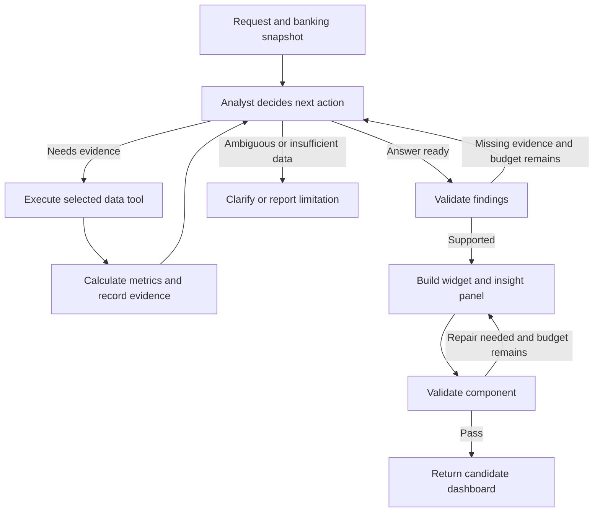

# Agentic investigation with LangGraph

Date: 2026-11-08
Status: Proposed implementation; no application changes included.

## Objective

Use LangGraph's TypeScript runtime to make the application's investigation, evidence handling, and repair paths explicit. Extend the existing query loop so the model investigates a user's question, gathers supporting evidence, and creates a useful interface around its findings.

The current query-and-observe loop already has agentic behavior. Adopting a framework does not create autonomy by itself. The substantive improvement is allowing observations to change what the model investigates next and requiring evidence before it presents a finding.

This plan complements [the insights implementation plan](../insights/implementation-plan.md). That document defines evidence, metrics, presentation, and freshness requirements; this document describes their orchestration with LangGraph.

## Framework choice

- **LangChain** provides model integrations, tools, and higher-level agent abstractions.
- **LangGraph** provides explicit shared state, nodes, conditional routing, and cycles. It is the recommended orchestration layer for this application.
- Retain TypeScript, Next.js, the existing OpenRouter model wrapper, Nessie adapter, and query executor. A Python service is unnecessary.
- LangGraph does not require replacing the current model client with a LangChain integration.
- Initially use the existing validated JSON query/finish protocol inside custom graph nodes. Native provider tool calling and `ToolNode` can be evaluated separately; neither is necessary for the first migration.
- Verify the installed LangGraph API and compatible package versions before implementation. Do not copy outdated examples blindly.

References: [LangGraph overview](https://docs.langchain.com/oss/javascript/langgraph/overview), [workflows and agents](https://docs.langchain.com/oss/javascript/langgraph/workflows-agents).

## The behavior that makes this agentic

Change the analyst's goal from:

> Do I have enough data to draw the requested widget?

To:

> Answer the user's analytical question with supported findings, then build an interface that makes those findings understandable and useful.

For a request such as "Why was October more expensive?", the agent might:

1. Compare September and October spending using explicit, comparable periods.
2. Inspect category differences.
3. Discover that restaurants barely changed and investigate another category.
4. Identify shopping as the largest contributor to the recorded increase.
5. Inspect merchants within shopping if further evidence would improve the answer.
6. Finish with an evidence-backed explanation, an appropriate view, limitations, and a follow-up action.

On a different dataset, it might find incomplete history and ask for clarification, choose a different comparison, or report that no supported explanation was found. Do not hardcode the restaurant -> shopping -> merchant sequence. Evidence should determine the path.

Recorded category or merchant contributions explain the composition of a spending change; they do not establish a person's motivations or other causal explanations.

## Proposed graph

The graph encodes permitted transitions. The model chooses its next action within those boundaries. Ordinary application code enforces budgets, tool permissions, evidence validation, and publishing rules.

Every conditional route needs an explicit terminal outcome when its budget is exhausted. A recursion-limit exception is a last-resort guard, not the normal user-facing completion mechanism.

Theme/removal requests bypass financial investigation. Keep a valid chart when no supported insight is available, with an honest insufficient-evidence status. Preserve the prior dashboard when a proposed component cannot pass existing checks.

## Nodes and responsibilities

| Node | Execution | Responsibility |
| --- | --- | --- |
| Analyst | Nemotron | Choose a query, interpret observed metrics, propose supported findings, clarify, or finish. |
| Data tools | Application code | Execute schema-validated queries over the current banking snapshot. |
| Metrics and evidence | Application code | Calculate changes and contributions; retain query results and provenance; assign evidence/metric IDs. |
| Findings validator | Application code initially | Reject nonexistent references, inconsistent numbers, incompatible comparisons, and unsupported claim structures. |
| UI builder | Nemotron | Select or generate a view and interpret validation errors during a bounded repair cycle. |
| Component validator | Application code | Apply current restrictions and compilation checks; produce concrete repair feedback. |
| Candidate assembly | Application code | Return a validated widget and its analysis together for the existing browser commit flow. |

The analyst and builder are separate model roles. The remaining nodes do not need to be agents. All model roles can use the same Nemotron endpoint.

Numeric/reference validation does not prove arbitrary natural-language explanations true. Follow the insights plan's typed numerical claims and restrictions on unsupported interpretations.

## Shared graph state

Define typed state for a single run containing:

- Run ID, user request, requested operation, and selected widget/context.
- Input dashboard version and candidate dashboard change.
- Banking snapshot identity and access to the immutable snapshot for this run.
- Executed query specifications, results, errors, and observation history.
- Deterministically calculated metrics and evidence IDs.
- Proposed findings, relevance, limitations, and follow-up specifications.
- Primary visualization query, separately from supporting investigation queries.
- Builder output and component validation errors.
- Investigation steps, tool executions, model calls, repair attempts, and deadline.
- Completion status, including insufficient evidence or clarification.

Retain the complete evidence required for deterministic calculations while sending only bounded observations to the model. Define append versus replace behavior explicitly for state collections so subsequent nodes cannot accidentally discard earlier evidence.

Keep credentials outside graph state and model prompts. Do not stream raw snapshots, private records, or full graph state to the browser merely to show progress. If checkpointing is added, deliberately choose what is persisted and how snapshot access is restored.

The current loop discards observations when it finishes. Preserving them through the graph is essential for validation, UI construction, and follow-up context.

## Tools

Start with existing capabilities rather than a large new tool catalog:

1. Execute a validated `DataQuery` using `executeQuery()`.
2. Calculate supported comparison metrics from registered evidence.
3. Inspect additional category/merchant aggregations through further validated queries.

The model chooses query parameters and whether another investigation is useful. Application code performs financial arithmetic and verifies account scope.

Retain the distinction between the question a widget displays and the supporting queries used to investigate it. The last executed query must not automatically become the chart's data binding.

## Incremental migration

### 1. Port the existing loop without changing behavior

- Read applicable `AGENTS.md` instructions and relevant installed Next.js documentation before changing application code.
- Add compatible `@langchain/langgraph` and `@langchain/core` dependencies.
- Replace the `for` loop in `agentLoop()` with an analyst node, query executor, and conditional routing.
- Reuse `modelJSON()`, current schemas, `executeQuery()`, cancellation, and error reporting.
- Preserve the current requirement that add/update operations successfully inspect their final display query.
- Keep `runAgents()` as the route-facing entry point while moving graph construction into a focused server module.
- Demonstrate parity for add/update, theme, remove, clarify, and error outcomes before introducing new analytical behavior.

### 2. Add evidence and analytical completion

- Introduce the evidence and metric contracts from the insights plan.
- Store observations in shared state instead of discarding them on completion.
- Give the analyst metric feedback and structured finish fields referencing evidence.
- Add the findings validator and route useful validation feedback back to the analyst within budget.
- Support an explicit insufficient-evidence outcome without fabricating a takeaway.

### 3. Move building and repair into the graph

- Wrap the existing UI builder and component checks as nodes.
- Pass the primary query result and validated analysis summary to the builder.
- Route compilation/restriction errors back to the builder with an explicit repair counter.
- Keep insight ownership and financial arithmetic outside generated component code.
- Return the candidate widget and analysis atomically.

The current browser preview still gates publication of new custom components. Initially preserve that boundary outside the server graph: server graph completion means the candidate passed server checks, not that the browser has rendered it successfully. Routing browser failures back into a graph would require a deliberate continuation protocol and is deferred.

### 4. Connect progress and follow-ups

- Map graph node updates and safe custom progress messages into the existing NDJSON response.
- Display concise events such as "Comparing periods", "Inspecting category changes", and "Checking evidence".
- Do not expose private reasoning text as progress. Show selected actions, results summaries, and validation outcomes.
- Pass selected widget and insight context on follow-up investigations rather than relying on an unqualified "why?" message.
- Revalidate/recompute client-supplied context against the current snapshot.

LangGraph supports node-update and custom-event streaming: [streaming documentation](https://docs.langchain.com/oss/javascript/langgraph/streaming).

### 5. Add persistence only when needed

Shared state persists throughout an invocation without implying crash recovery or cross-session learning. For the prototype, keep the current single-active-run model and existing dashboard persistence.

If pause/resume or recovery across server restarts becomes necessary, add an appropriate persistent checkpointer, stable run identifiers, and snapshot consistency rules. In-memory state alone is not durable recovery. Checkpointing also does not implement the deferred behavioral-learning feature.

## Budget and failure handling

- Initially preserve the existing six analyst-decision budget and bounded component repairs.
- Track model requests, including structured-output repair calls, separately from analyst decisions.
- Bound tool executions and total wall-clock time. Propagate cancellation to model requests and banking operations.
- Avoid repeated identical queries by reusing successful evidence within the same snapshot.
- Use a graph recursion limit as an additional guard; account for tool and metric nodes when choosing it rather than equating graph steps with model decisions.
- On exhausted analytical budget, produce only findings supported by existing evidence or report insufficient evidence.
- On exhausted component-repair budget, retain the prior dashboard.
- Keep API/provider failures explicit; do not silently replace live execution with a fake successful demo.

## Proposed code organization

| Location | Change |
| --- | --- |
| `lib/server/orchestrator.ts` | Keep route-facing orchestration and demo compatibility; delegate the live run to the compiled graph. |
| `lib/server/agent-graph.ts` (new) | State definition, nodes, conditional routes, budgets, and graph construction. |
| `lib/server/model.ts` | Preserve the current OpenRouter adapter and structured-output validation. |
| `lib/analysis.ts` (planned in insights work) | Deterministic metrics, evidence checks, claim formatting, and freshness. |
| `lib/contracts.ts` | Analysis contracts, selected-widget context, and safe progress events. |
| `app/api/agent/route.ts` | Continue serving the existing NDJSON interface; forward safe graph progress and cancellation. |
| `components/widgets.tsx` and `components/dashboard.tsx` | Shared insight rendering, selected follow-up context, and existing commit/undo behavior. |
| `tests/` | Graph routing, evidence, budget, cancellation, and regression tests. |

## Verification: prove that evidence changes the path

Use deterministic snapshots and mocked model responses for automated tests. Record actions, tool arguments, evidence IDs, and transitions so tests assert behavior rather than merely checking fluent final text.

Required scenarios:

1. A restaurant increase leads to a restaurant merchant investigation.
2. Restaurants are stable, so the agent pursues a different supported category.
3. Incomplete periods cause clarification or a qualified comparison instead of an unsupported conclusion.
4. No notable pattern produces an honest result without an invented anomaly.
5. A fabricated metric/evidence ID triggers repair or insufficient-evidence completion.
6. An invalid component causes bounded builder repair; repeated failure preserves the dashboard.
7. Theme/removal requests skip financial investigation.
8. Cancellation and exhausted budgets terminate cleanly.
9. The original display query survives supporting drill-downs.
10. Existing insights freshness and persistence checks still pass.

Mocked traces verify routing and safeguards. Also run a small live-model evaluation over the contrasting fixtures to check whether the model actually chooses appropriate investigations. A graph with conditional edges does not, by itself, prove useful model decision-making.

After implementation, run the project's tests, lint, and build, then manually verify streamed progress, the browser preview gate, evidence presentation, follow-ups, undo, and data refresh.

## Definition of done

- The model can choose different investigative paths based on observed evidence.
- Findings are linked to validated server-calculated metrics.
- The primary display query and supporting evidence survive the complete run.
- Investigation and repair cycles have explicit budgets and terminal outcomes.
- Existing UI, provider integration, and browser preview behavior remain usable.
- The demo can show an action/evidence trace that explains what was investigated and why the result is supported.

## Deferred

- Behavioral learning and long-term personalization.
- Autonomous financial transactions or unrestricted backend tools.
- Separate services or a large collection of independently running agents.
- Durable graph deployment, checkpoint databases, and browser-to-graph continuation unless the prototype requires them.
- Replacing the working OpenRouter integration solely to adopt a framework.
